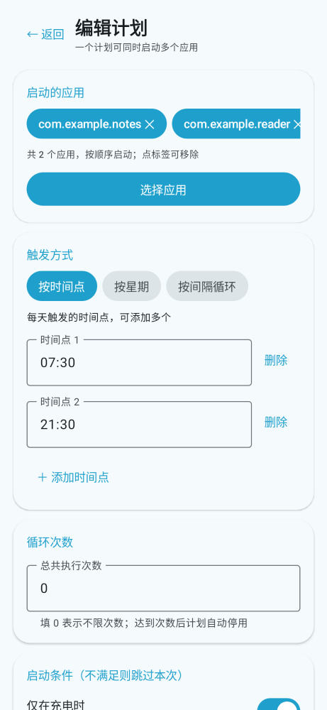
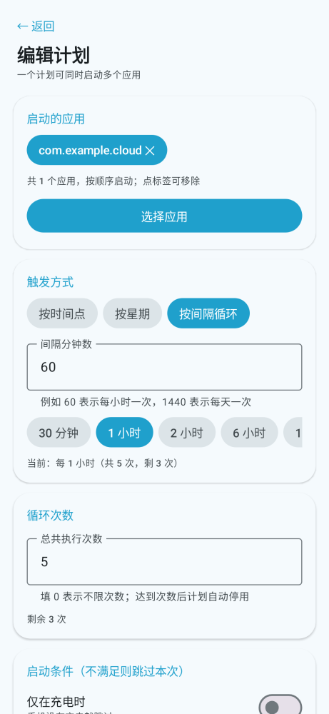
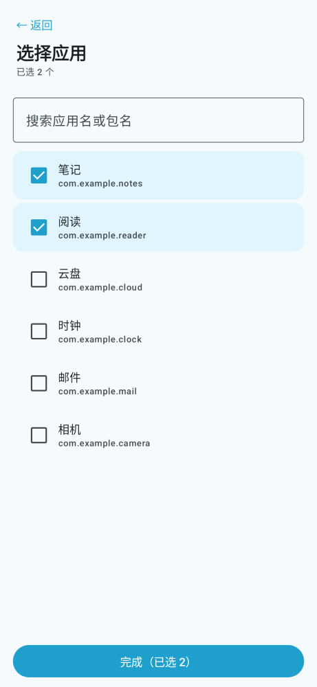
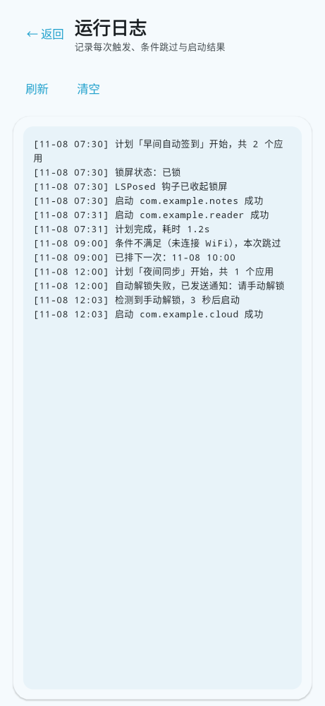

# 定时启动 App · LSPosed 模块

本目录是 `lsposed` 分支独有的 Gradle 工程，产物为可安装的 Xposed 模块 APK。与 `main` 分支的 Magisk 版相比：

| 对比项 | Magisk 版（`main`） | LSPosed 版（`lsposed`） |
| --- | --- | --- |
| 形态 | Magisk 模块 ZIP（纯 shell） | APK（Xposed 模块） |
| 调度 | BusyBox `crond` + crontab | `AlarmManager`（每个计划一个闹钟） |
| 应用数量 | 一个固定包名 | **一个计划可同时启动多个 App** |
| 定时方式 | crontab 表达式 | **按时间点 / 按星期 / 按间隔循环** |
| 启动条件 | 无 | **仅充电 / 仅 WiFi / 仅屏幕熄灭** |
| 解锁 | `wm dismiss-keyguard` → 上滑 + `input text` | **SystemUI 内钩子收起 Keyguard** → `wm` → 上滑 + `input text` |
| 执行权限 | 模块脚本天然 root | App 内 `su -c` |
| 配置 | 编辑 `config.sh` | App 界面（应用选择器 / 计划编辑 / 条件开关） |

## 功能

- **应用选择器**：读取已安装的可启动应用（名称 + 包名），搜索、多选，无需手输包名。
- **多 App 同时启动**：一个计划里可选多个应用，按顺序 `force-stop` 后逐个启动。
- **多计划**：可建任意多个计划，各自独立的定时、次数、条件、启用状态。
- **三种定时方式**：
  - 按时间点：每天多个 `HH:MM`（如 08:00、20:00）；
  - 按星期：勾选周一～周日（不勾＝每天）+ 一个时间点；
  - 按间隔循环：每 N 分钟（含 30 分钟 / 1 小时 / 2 小时 / 6 小时 / 12 小时 / 24 小时快捷项）。
- **循环次数**：填 0 表示不限；大于 0 时每跑一次减一，跑完自动停用计划。
- **启动条件**：仅充电时 / 仅连 WiFi / 仅屏幕熄灭，任一不满足则跳过本次并写日志。
- **手动解锁兜底**：自动解锁失败时不放弃，等用户自己解锁后自动继续启动。
- **运行日志**：记录触发、条件跳过、解锁路径与启动结果，可一键清空。

## 界面（Kotlin + Jetpack Compose）

**Kotlin 2.0.21 + Jetpack Compose（Material3，Compose BOM 2024.09.03）**，四个页面：

| 页面 | 内容 |
| --- | --- |
| 计划列表 | 调度总开关 + 下次执行时间；每个计划一张卡片（应用、计划描述、条件、上次结果、启用开关、编辑/删除/立即执行）；全局设置卡（锁屏密码、手动解锁兜底开关与最长等待秒数） |
| 计划编辑 | 已选应用标签（点一下移除）+「选择应用」；触发方式三选一；循环次数；三个启动条件开关；「保存计划」 |
| 应用选择 | 搜索框 + 已安装应用列表（复选框多选），底部「完成（已选 N）」 |
| 运行日志 | 等宽字体只读日志 + 刷新 / 清空 |

配色与布局参考开源项目 **Sesame-AG** 的 Compose 主题：主色 `#1FA0CC`（青蓝）、主色容器 `#BBEAFF`、次色 `#4C616B`、背景/表面 `#F5FAFD`、错误色 `#BA1A1A`，卡片圆角 20dp；另有深色方案，Android 12 及以上启用系统动态取色。只借鉴设计风格，未引入其任何业务代码。

### 截图

| 计划列表 | 计划编辑（按时间点） | 计划编辑（按间隔循环） |
| --- | --- | --- |
|  |  |  |

| 选择应用 | 运行日志 |
| --- | --- |
|  |  |

这些 PNG 由 **Paparazzi（layoutlib）直接渲染本仓库的真实 Compose 代码**得到，不是设计稿：

```bash
gradle -p lsposed :app:recordPaparazziDebug
# 产物在 lsposed/app/src/test/snapshots/images/
```

场景定义在 `app/src/test/java/com/appscheduler/lsposed/ScreenshotTest.kt`：构造三个样例计划（按时间点 / 按间隔循环 + 次数 / 按星期且停用）、两份计划编辑页、一份已选两个应用的列表、一段含条件跳过与手动解锁兜底的日志。渲染时固定 `dynamicColor = false`，确保截图呈现上面这套青蓝配色而不受布局库取色影响。

计划数据的存读另有一组纯 JVM 回归测试（`TaskItemTest`，真实 `org.json` 走序列化往返），CI 在打包前会先跑它：

```bash
gradle -p lsposed :app:testDebugUnitTest --tests 'com.appscheduler.lsposed.TaskItemTest'
```

对应文件：

```
ui/MainScreen.kt        # 四屏导航（列表 / 编辑 / 选应用 / 日志）
ui/TaskListScreen.kt    # 计划列表 + 全局设置
ui/TaskEditScreen.kt    # 计划编辑（定时方式 / 次数 / 条件）
ui/AppPickerScreen.kt    # 已安装应用搜索与多选
ui/LogScreen.kt         # 日志
ui/Common.kt            # ScreenHeader / SectionCard / ChoiceChip / SwitchRow
ui/Theme.kt             # Material3 配色 / 深色 / 动态取色
```

Java 侧只保留执行与钩子（`TaskRunner` / `XposedEntry` / `Config` / `LogStore`），注入 SystemUI 的钩子不依赖 Kotlin 运行时；调度、数据与界面均为 Kotlin。

## 应用图标

<p align="center"></p>

一枚青蓝底色、白色圆环表盘的时钟：时针指 8 点、分针指 12 点，秒针斜指 4 点；四个方位用更深一档的青蓝小圆点作刻度。图形只靠轮廓与色块识别，缩小到 48dp 仍清晰，也不出现任何文字。

外形按 MIUI / HyperOS 桌面规范处理：不用 Apple 式的单一圆角矩形，而是 `|x|^n + |y|^n = 1`（n = 4）的超椭圆 squircle——圆角过渡更饱满、四边更直，和系统自带图标放在一起既不会显得"方正"，也不会圆过头。表盘外接框收紧到图标边长的 64.5%，四周留足呼吸区，避免上机后贴边显大。

资源按 Android 规范铺满五个密度：

| 文件 | 用途 |
| --- | --- |
| `res/mipmap-*/ic_launcher.png` | 传统方形图标（48/72/96/144/192），超椭圆圆角遮罩 |
| `res/mipmap-*/ic_launcher_round.png` | 圆形启动器图标（同一套尺寸，圆形遮罩） |
| `res/mipmap-*/ic_launcher_foreground.png` | 自适应图标前景（108/162/216/324/432，图形占画布 43%，裁到 72dp 可见区后仍是 64.5%） |
| `res/mipmap-anydpi-v26/ic_launcher.xml`、`ic_launcher_round.xml` | Android 8+ 自适应图标，前景 + `@color/ic_launcher_background` 纯色底 |
| `res/values/colors.xml` | 图标底色 `#2297D5`，取自母图背景，避免与前景出现色差接缝 |

图标母图（2048×2048）与切图流程都留在仓库外，重新生成只需把母图替换进切图脚本；`docs/icon.png` 是给 README 用的 512px 预览。

## 工作原理

1. **数据**：每个计划是一个 `TaskItem`（应用列表、定时方式、星期、时间点、间隔、次数、条件、启用），整表以 JSON 存在 `SharedPreferences`（`TaskStore`）。
2. **调度**：`Scheduler` 为每个计划单独排一个 `PendingIntent`（请求码固定，用 `appschedule://task/<id>` 作为 data 区分，避免 id 相差 900 时互相覆盖），用 `setExactAndAllowWhileIdle`；无精确闹钟权限时降级 `setAndAllowWhileIdle`；`BootReceiver` 开机重排。
3. **执行载体**：闹钟与解锁广播都不自己干活，只负责把活交给 `RunService`（前台服务，`specialUse` 类型）。前台服务有进程优先级、不受广播接收器约 10 秒窗口限制；系统若拒绝后台启动前台服务，则退化为接收器里起线程执行，两条路都不会长时间阻塞广播。
4. **条件**：`RunCoordinator.executeTask` 先过 `ConditionChecker`（充电 / WiFi / 屏幕熄灭），不满足则记日志并直接排下一次。
5. **解锁与启动**：`TaskRunner` 通过 `su -c`（每条命令 20 秒超时）依次执行 `pm list packages` 校验（逐行精确比对，避免包名互为前缀时误判）、`input keyevent 224` 唤醒、广播收起锁屏、`wm dismiss-keyguard`、上滑 + `input text` + 回车，然后对每个应用 `am force-stop` + `monkey` → 解析 Activity 后 `am start`。解锁只做一次，整个计划共享。锁屏状态先读 `dumpsys window` 的 `isKeyguardShowing`，读不到再退回 `dumpsys window policy` 的 `mKeyguardShowing`（HyperOS 的 `window policy` 段没有前者，只查那一处会把「已解锁」误判成「锁屏中」），两处都读不到时才按锁屏处理。
6. **手动解锁兜底**：自动解锁仍失败且开关打开时，把本次要启动的包写入 `PendingStore`、发通知「请手动解锁」（Android 13+ 首次启动时申请通知权限），再排一个截止闹钟；随后**立刻返回，不占用任何广播窗口**。用户解锁后系统发 `USER_PRESENT`，`UnlockReceiver` 接管并送去前台服务启动 App；到截止时间仍未解锁，由超时闹钟清理条目并发失败通知。
7. **钩子**：`XposedEntry` 只作用于 `com.android.systemui`：
   - 挂钩 `Application.onCreate`，在其中注册 `com.appscheduler.action.DISMISS_KEYGUARD` 广播接收器；该接收器要求发送方持有 `com.appscheduler.permission.DISMISS_KEYGUARD`（signature 级别），第三方 App 无法伪造「收起锁屏」广播；
   - 挂钩 `com.android.systemui.keyguard.KeyguardViewMediator` 的构造函数捕获实例；
   - 收到广播后按候选方法列表反射调用：`dismissKeyguard()` → `handleHideKeyguard(boolean)` → `handleHideKeyguard(boolean, boolean)` → `setShowingLocked(false, true)` → `hideKeyguard()`，先找本类声明的方法、再找继承来的，逐个尝试并在 LSPosed 日志中记录结果。
8. **精确闹钟**：系统未授予「闹钟与提醒」权限时，计划列表的全局设置卡会直接显示提示与跳转入口，调度自动降级为非精确。
9. **不会卡死**：通知的建渠道与发送全部丢到独立线程做尽力投递，执行链不等 binder；前台服务另有 180 秒看门狗，超时强制摘除通知并收尾，不会留下「正在执行」的永久通知。

## 构建

全部在 GitHub Actions 内完成（JDK 17 + Gradle 8.7 + Android SDK）：

```bash
# 触发一次分支构建
git push origin lsposed

# 或者打标签发布 Release
git tag lsposed-v1.5.6 && git push origin lsposed-v1.5.6
```

本地等价命令（需要本机 Android SDK）：

```bash
gradle -p lsposed :app:assembleRelease
```

## 安装

1. 下载 `app-scheduler-lsposed-v1.5.6.apk`；
2. 正常安装（授予 root 权限提示时允许）；
3. LSPosed 管理器 → 模块 → 启用「定时启动 App · LSPosed」→ 勾选作用域 **System UI**（`com.android.systemui`）；
4. 重启手机（或重启 SystemUI）；
5. 打开 App：填锁屏密码 → 点「新建启动计划」→ 选择应用 → 选触发方式与条件 → 保存；
6. 回到列表确认「调度总开关」为开启（首次安装默认开启），需要时保存全局设置。

## 验证钩子是否生效

```bash
# LSPosed 日志
logcat -s LSPosed | grep AppScheduler
```

日志中应出现：

```
[AppScheduler] 模块已注入 com.android.systemui
[AppScheduler] 已挂钩 Application.onCreate
[AppScheduler] 已挂钩 com.android.systemui.keyguard.KeyguardViewMediator
[AppScheduler] 已捕获 KeyguardViewMediator 实例
```

若 `handleHideKeyguard` 等候选方法在 HyperOS 上不存在，日志会输出每个候选失败的异常，此时模块自动退回 `wm dismiss-keyguard` 与上滑密码路径，功能不会中断。

> 说明：`xposed-api-stub/` 只是编译期桩模块（`compileOnly`），提供 `de.robv.android.xposed` v82 的接口签名，不会打进 APK；运行期由 LSPosed 提供实现。

## 许可证

GNU General Public License v3.0（GPL-3.0），完整条款见仓库根目录 [`LICENSE`](../LICENSE)。分发修改版本时须同样以 GPL-3.0 开源并保留版权声明。
