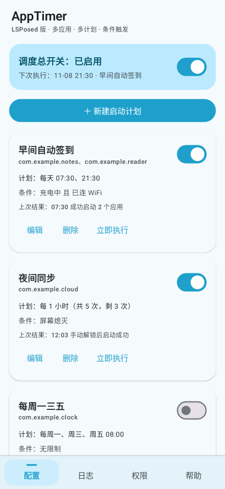
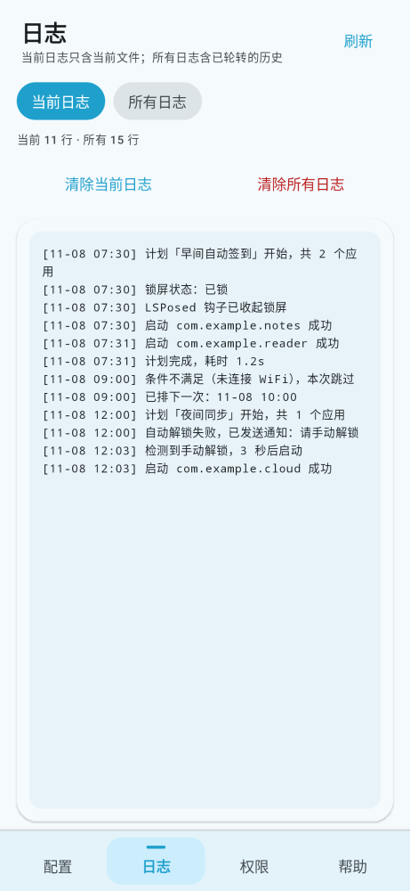
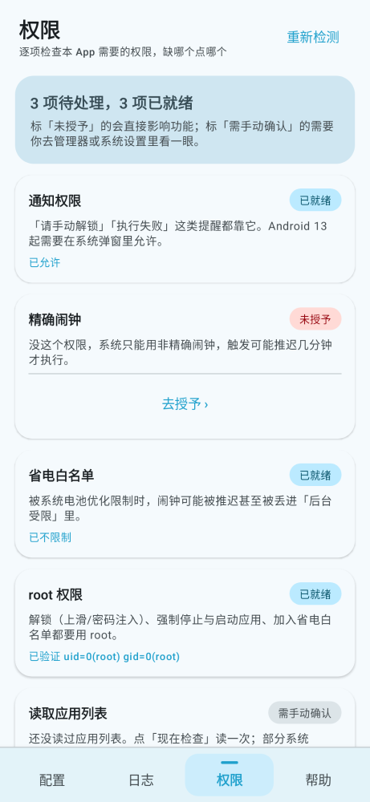
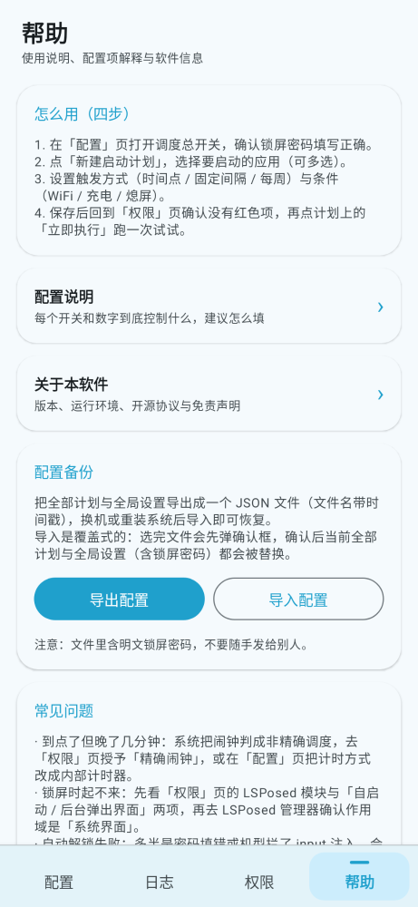
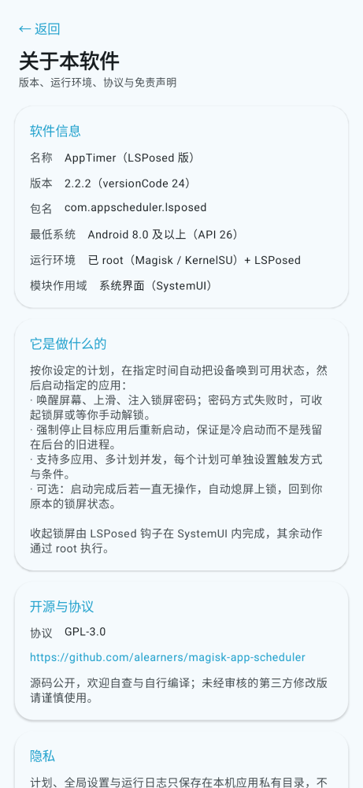

# AppTimer · LSPosed 版

> **风险自负**：本模块会以 root 身份替你解锁屏幕、启动 App，并在你无操作时关闭屏幕。误配可能导致设备被锁、数据丢失或锁屏密码泄露。完整免责条款见仓库根目录 [`README.md`](../README.md) 顶部「使用前必读」与末尾「免责声明」。

本目录是 `lsposed` 分支独有的 Android 工程，产物为 `apptimer-lsposed-vX.apk`。

## 它和 Magisk 版的差别

| 维度 | Magisk 版（`main` 分支） | 本版（`lsposed` 分支） |
| --- | --- | --- |
| 形态 | 纯 shell 模块 | APK + Xposed 入口 |
| 调度 | crontab / 内部 sleep 循环 | 界面配置：时间点 / 星期 / 间隔，带次数与条件 |
| 触发载体 | crond 或后台循环 | 系统闹钟，或常驻前台服务计时 |
| 解锁 | `wm dismiss-keyguard` → 上滑 + 注入密码 | SystemUI 钩子收起 Keyguard → `wm` → 注入密码兜底 |
| 应用数量 | 一个固定包名 | 一个计划可启动多个 App |
| 配置 | 编辑 `config.sh` | 图形界面 |

功能对齐的几项（两边都有）：多 App 顺序启动、解锁校验与兜底、无操作自动锁屏（可配秒数、切走不误锁）、计时基准二选一、失败通知与日志、**配置导出与导入**。

## 界面结构

底部菜单栏四个入口，所有页面都在这里进：

| Tab | 内容 |
| --- | --- |
| 配置 | 调度总开关、计划列表（新建 / 编辑 / 删除 / 立即执行）、全局设置（锁屏密码、手动解锁兜底、最长等待、自动锁屏与延时、计时方式）、系统权限提示 |
| 日志 | 「当前日志 / 所有日志」两个视图，可分别刷新与清除 |
| 权限 | 通知、精确闹钟、省电白名单、root、LSPosed 作用域、应用列表、厂商后台限制逐项体检，缺哪项就点哪项去申请 |
| 帮助 | 使用步骤、**配置说明**（逐项解释每个开关）、**配置备份**（导出 / 导入）、常见问题，以及 **关于本软件**（版本、运行环境、开源协议、隐私与免责声明） |

**计划编辑 / 选择应用**是整屏子页面，从「配置」页进入，不占用底部栏。

权限页只读取状态、不主动弹系统授权框；点了「去授予 / 去设置 / 验证 root / 现在检查」才会跳转或执行。「读取应用列表」一项只读缓存结果——部分系统（HyperOS、MIUI）第一次查包列表就会弹「取得已安装的应用程式资讯」，所以这一步被挪到你主动点「现在检查」时，或在你第一次打开「选择应用」时顺带记录。



| 日志（当前） | 权限 |
| --- | --- |
|  |  |

| 帮助 | 关于本软件 |
| --- | --- |
|  |  |

截图由 Paparazzi 在 JVM 上渲染真实 Compose 界面生成（`gradle :app:recordPaparazziDebug`），不是手绘的示意图。

## 配置备份

导出 / 导入放在**「帮助」页**的「配置备份」卡片里（「配置」页只留一个跳转入口），避免在计划列表里误触覆盖。两个按钮：

- **导出配置**：走系统文件选择器（SAF），把全部计划 + 全局设置写成 `apptimer-config-YYYYmmdd-HHmm.json`；
- **导入配置**：选 JSON → 校验（是不是 AppTimer 的、`schema` 是否比当前新）→ 弹确认框 → **覆盖**当前全部计划与全局设置，写完立刻按新的 `timerMode` 重排闹钟或拉起内部计时器。

JSON 结构（`schema=1`）：

```json
{
  "app": "AppTimer",
  "schema": 1,
  "exportedAt": "2026-11-10T11:00:00",
  "versionName": "2.1.0",
  "global": {
    "enabled": true, "password": "……", "manualFallback": true, "manualWait": 120,
    "autoLock": false, "autoLockDelay": 5, "timerMode": "alarm"
  },
  "tasks": [ { "name": "…", "packages": ["…"], "scheduleType": "INTERVAL", "intervalMinutes": 60, … } ]
}
```

导入时计划会被重新编号（`id` 从 1 起）并把自增游标拨到最大值 + 1，所以导入不会和「新建计划」抢同一个 id；`maxRuns > 0` 但 `remainingRuns <= 0` 的「已跑完」计划会被拉回满次数，避免导入一份备份后计划一进来就是死的。

文件含**明文锁屏密码**；导入是覆盖式的，动手前先导出一份现有配置更稳。Magisk 版的备份是 `.sh`（`config.sh` 副本），与本版的 `.json` **互不通用**。

## 包信息

| 项 | 值 |
| --- | --- |
| applicationId | `com.appscheduler.lsposed` |
| 显示名 | `AppTimer` |
| 版本 | `versionCode 24` / `versionName 2.2.2` |
| 最低支持 | Android 8.0（API 26） |
| 目标 SDK | 34 |
| 签名 | 仓库固定密钥（`CN=App Scheduler, O=alearners, C=CN`），证书 SHA-256 `10948BFB9…000B2E5` |

`applicationId`、Kotlin 包名、`Config.PREFS`、权限名与 action 前缀都保持 `appscheduler` 不动：改它们会让 LSPosed 作用域、`signature` 权限与既有安装的覆盖升级链路全部失效。改名只动显示名、产物文件名与文案。

## 代码结构

```
lsposed/app/src/main/
├── java/com/appscheduler/lsposed/
│   ├── MainActivity.kt / XposedEntry.java      # 入口与钩子
│   ├── AutoLock.kt                             # 无操作自动锁屏（arm → 原地等秒 → fire）
│   ├── RunService.kt                           # 前台服务：执行任务、等秒、守候解锁
│   ├── TimerService.kt                         # 「应用内部计时器」模式下的常驻计秒服务
│   ├── RunCoordinator.kt / TaskRunner.java     # 执行编排与 su 调用
│   ├── schedule/                               # 调度器与接收器
│   ├── store/                                  # 计划、挂起队列、日志
│   ├── transfer/ConfigTransfer.kt              # 配置导出 / 导入（JSON 校验、覆盖写入、重排）
│   ├── permissions/PermissionAudit.kt           # 权限体检：只读判定 + root 验证
│   └── ui/                                     # Compose 界面
│       ├── MainScreen.kt / BottomBar.kt        # 底部菜单栏与页面路由
│       ├── TaskListScreen.kt / TaskEditScreen.kt / AppPickerScreen.kt   # 配置页
│       ├── LogScreen.kt                        # 日志页（当前 / 全部）
│       ├── PermissionScreen.kt                 # 权限页
│       └── HelpScreen.kt                       # 帮助 / 配置说明 / 关于本软件
└── res/                                        # 图标、文案（app_name=AppTimer）
```

## 构建

```bash
cd lsposed
./gradlew :app:assembleRelease
# 产物：app/build/outputs/apk/release/app-release.apk
```

没有本地 Android SDK 时直接用仓库的 Actions：push 到 `lsposed` 分支即编译并上传 artifact；打 `lsposed-v*` 标签会额外发布 Release。

## 真机自查清单

装完后按顺序确认，每步只看一件事：

1. LSPosed 作用域勾选「系统界面」，重启一次；
2. 进「权限」页，把红色项逐项点掉（通知 / 精确闹钟 / 省电白名单 / root 验证）；灰项「LSPosed 模块」「厂商后台限制」按提示去管理器与系统设置确认；
3. 建一个 1 分钟间隔、只启动单个 App 的计划，等一轮，看日志里是否有「定时触发 → 解锁 → 启动」；
4. 打开「启动后无操作自动锁屏」，填 5 秒，等下一轮，确认日志出现「启动后 5 秒无操作，已自动熄屏上锁」；
5. 同一轮里触发后立刻切到别的界面，确认日志出现「前台已是…，判定为用户已接管，跳过」，且屏幕没有被关掉；
6. 进「帮助」页点「导出配置」存一份，删掉一个计划后再点「导入配置」，确认计划与全局设置都回到导出时的状态、日志里出现「导入配置：已导入 N 个计划」；
7. 「日志」页切到「所有日志」确认能看到轮转前的历史，再分别点「清除当前日志」「清除所有日志」，确认对应视图变空、另一份不受影响。

任何一步不符合预期，先看日志再改参数；不要同时改多个设置。
