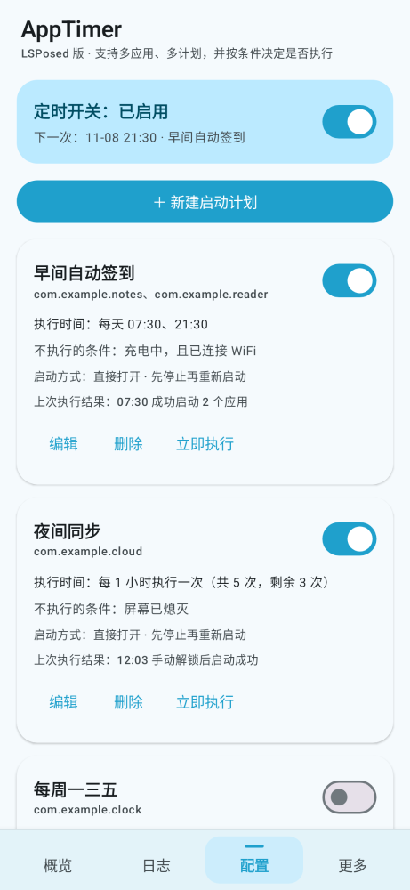
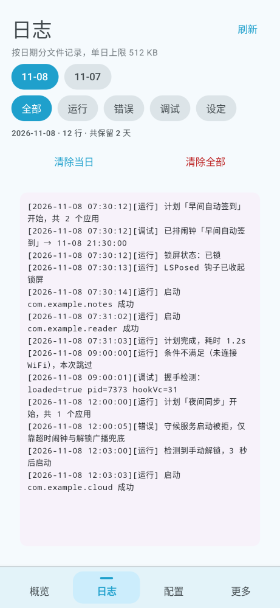
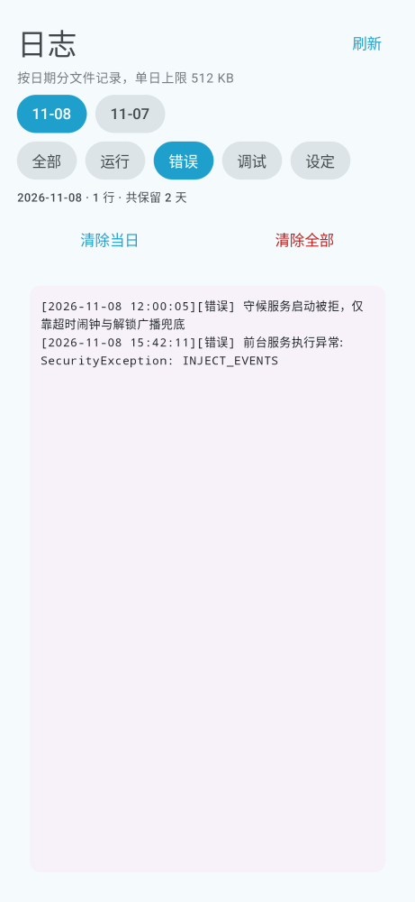
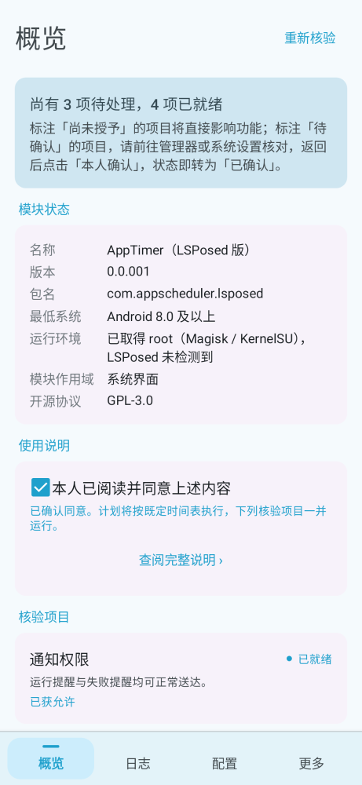
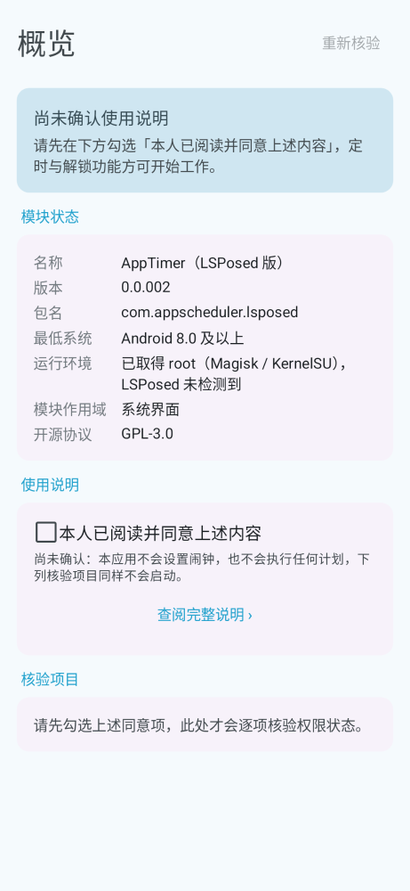
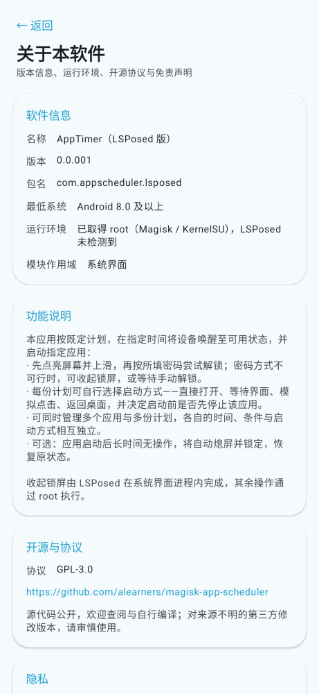
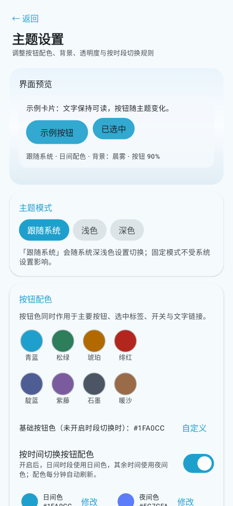
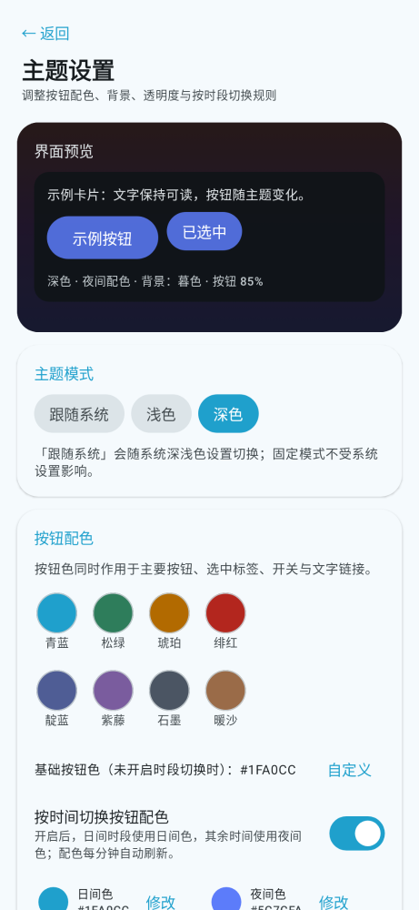
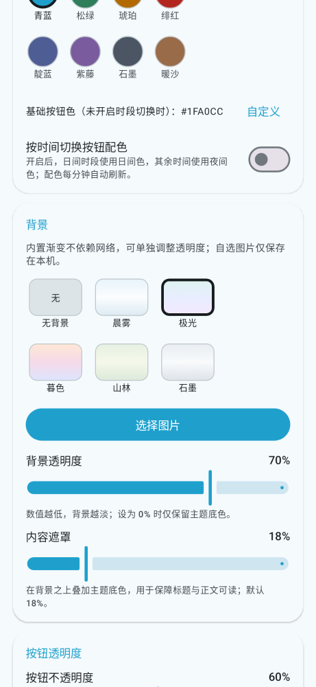
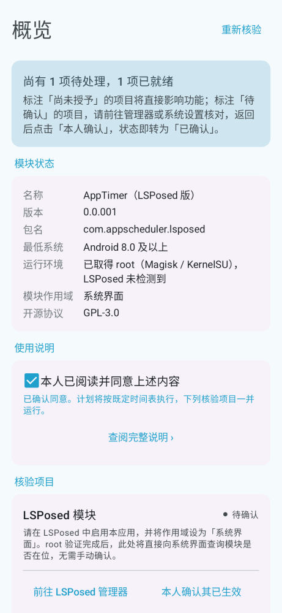

# AppTimer · LSPosed 版

> **风险提示**：本模块以 root 权限代为解锁屏幕、启动应用，并在无人操作时熄屏锁定。配置不当可能导致设备被锁于系统之外、数据丢失或锁屏密码泄露。完整声明见仓库根目录 [`README.md`](../README.md) 开头与结尾，安装前请务必阅读。

本目录为 `lsposed` 分支的 Android 工程，产物为 `apptimer-lsposed-vX.apk`。

## 使用说明与确认项

使用说明与免责声明全文位于「更多 → 使用说明」。确认勾选框在**「概览」页**，位于模块状态与核验项目之间。

勾选「本人已阅读并同意上述内容」后，定时功能开始排程，下列核验项目同步启动；**取消勾选后，全部闹钟立即撤销、计时服务停止**，任何计划均不再执行（`Config.agreed()` 为 false 时，`Scheduler.schedule` / `applyMode` / `RunCoordinator` 均直接返回，概览页核验亦停止）。

文案仅一份（`ui/Terms.kt`），勾选页与「更多 → 使用说明」共用同一份内容。

## 与 Magisk 版的差异

| 方面 | Magisk 版（`main` 分支） | 本版本（`lsposed` 分支） |
| --- | --- | --- |
| 形态 | 纯 shell 模块 | APK + Xposed 入口 |
| 定时配置 | crontab / 自行计时 | 界面配置：时间点 / 星期 / 间隔，可限次数、加条件 |
| 计时执行 | crond 或后台循环 | 系统闹钟，或常驻前台服务 |
| 解锁方式 | `wm dismiss-keyguard` → 上滑 + 输密码 | 系统界面钩子收起锁屏 → `wm` → 密码兜底 |
| 单次启动应用数 | 一个固定包名 | 一份计划可启动多个应用 |
| 配置方式 | 编辑 `config.sh` | 界面操作 |

两者共同具备：多应用按顺序启动、解锁后再次核验、无人操作自动锁屏（秒数可调、切换界面不误锁）、计时方式二选一、失败通知与日志，以及**配置导出导入**。

每份计划需设定两项相互独立的参数，均在新建 / 编辑计划页完成。

**第一项：启动方式（`launchMode`）**

| 方式 | 实际行为 | 可能情况 |
| --- | --- | --- |
| 直接打开（默认） | `am start -n <组件>` | 仅发送一条启动指令，不点击屏幕、不改系统设置。个别应用无法解析入口时将失败，日志记录「未找到该应用的启动入口」 |
| 等待界面 | `am start -W -n <组件>` | 待界面实际显示后继续，多耗时一至三秒；停留于开屏页者将等待至超时，本次计为失败 |
| 模拟点击 | `monkey -p <包> -c LAUNCHER 1` | 兼容性最好，但会注入触摸与导航事件。经实测，在澎湃上会开启系统「自动旋转屏幕」，亦可能误触界面中的其他控件 |
| 返回桌面 | `input keyevent 3` + `am start -n <组件>` | 等同从桌面图标点开；会打断当前操作并出现桌面闪烁，仅适用于个别必须在桌面环境下启动的应用 |

**第二项：启动前是否先停止应用（`forceColdStart`）**：开启时先执行 `am force-stop` 再启动，等同全新进入；关闭时不终止进程，应用仍在后台则回到上次退出的位置，速度较快。

两项可自由组合，例如「直接打开 + 先停止」「模拟点击 + 直接切换」。

## 界面结构

底部四个入口，从左至右为：概览 → 日志 → 配置 → 更多。

| 入口 | 内容 |
| --- | --- |
| 概览 | 模块状态（名称、版本、包名、最低系统、运行环境含 LSPosed 版本、作用域、协议）、使用说明确认勾选、逐项核验：通知、准时唤醒、省电白名单、root、LSPosed 作用域、应用列表、厂商后台限制。LSPosed 项在 root 验证后**主动探测**：向系统界面钩子发送握手请求，回话含钩子版本号即视为生效；版本不一致时提示重启系统界面；无回应时显示核验时间并指回管理器。厂商后台项系统无法查询实况，仍为「待确认」：前往应用详情确认后返回点击「本人确认其已生效」，状态即转为「已确认」 |
| 日志 | 每日一个文件，可切换日期、按级别筛选（全部 / 运行 / 错误 / 调试），另有「设定」用于调整单日文件上限（1–1024 KB）；可清除当日或全部日志 |
| 配置 | 定时总开关、计划列表（新建 / 修改 / 删除 / 立即执行）、全局设置（锁屏密码、等待手动解锁、等待时长、自动锁屏与延时、计时方式）、系统权限提示 |
| 更多 | 上手四步、**使用说明**（功能范围 / 风险 / 责任 / 禁止用途）、**启动方式**（四种方法的代价）、**配置说明**（各配置项含义）、**主题设置**（按钮配色 / 背景 / 透明度 / 按时段切换 / 预览）、**配置备份**（导出 / 导入）、常见问题，以及**关于本软件**（版本、运行环境、协议、隐私、免责声明） |

**新建 / 修改计划**与**应用选择**为整屏下一级页面，自「配置」页进入，不占底部栏。

**返回与菜单行为**：系统返回键先返回上一层，而非直接退出——应用选择 → 计划编辑 → 配置列表；「更多」中的说明子页 → 「更多」首页；其他入口 → 上一个访问过的入口，回到概览后方退出。点击当前底部入口等同返回其首页（在「更多」的说明子页再次点击「更多」，返回更多首页）。

概览页仅呈现状态，不会主动弹出系统授权框；点击「申请授权 / 前往设置 / 申请 root 授权 / 现在核验」后才会跳转或执行。「读取应用列表」仅读取上次结果——澎湃、MIUI 等系统首次统计应用时会征求「取得已安装的应用资讯」，因此该步骤移至主动点击「现在核验」，或在首次进入「应用选择」时记录。



| 日志（按日期、全部级别） | 日志（仅错误） |
| --- | --- |
|  |  |

| 概览 | 概览（尚未确认使用说明） |
| --- | --- |
|  |  |

| 更多 | 关于本软件 |
| --- | --- |
|  |  |

| 主题设置（浅色预览） | 主题设置（深色预览） |
| --- | --- |
|  |  |

| 主题设置（背景与透明度） |
| --- |
|  |

| 概览中的作用域与手动确认 |
| --- |
|  |

以上图片由 Paparazzi 在 JVM 上渲染真实 Compose 界面后截取（`gradle :app:recordPaparazziDebug`）。

## 开发表

如需在新环境中复现同等效果，参见 [`docs/dev-table`](../docs/dev-table)：21 段可独立粘贴的提示词，覆盖环境自检、数据层、定时、解锁、核验、日志、界面直至 CI 与发布，最后一段为发布后的导航说明。每行均注明验收标准与常见问题。表格版为 `AppTimer-开发表.xlsx`，阅读版为 [`开发表.md`](../docs/dev-table/开发表.md)。

## 日志

每日一个文件：`files/apptimer-2026-11-24.log`。每行自带时间与级别：

```
[2026-11-24 14:32:24][运行] 计划「早间签到」开始，共 2 个应用
[2026-11-24 14:32:24][调试] 已排定闹钟「早间签到」→ 11-24 21:30:00
[2026-11-24 14:32:31][错误] 守候服务启动失败，仅依靠超时闹钟与解锁广播兜底
```

| 级别 | 记录内容 |
| --- | --- |
| 运行 | 主要过程：触发、解锁、启动、条件不满足、导入导出——日常查看此级别 |
| 调试 | 细节：闹钟是否排定、为何撤销、握手时的进程号与钩子版本 |
| 错误 | 失败与异常（含错误对象），排查问题优先查看此级别 |

- 在「日志」页切换日期与级别；「清除当日」仅删除所选日期，「清除全部」删除所有日期的文件。
- 单日上限在「日志」页「设定」中调整，范围 1–1024 KB（默认 512）。达到上限后优先舍弃当日最早内容，文件首行保留 `...(更早的日志已按大小上限清理)`。
- 仅保留最近 30 天，更早文件在写入时删除。
- 旧版滚动文件（`apptimer.log` / `apptimer.log.1`）在升级后首次写入日志时并入当日文件。

## 配置备份

导出 / 导入位于**「更多」页**的「配置备份」卡片；「配置」页不再提供入口与说明，以免在计划列表操作时误覆盖配置。两个按钮：

- **导出配置**：通过系统文件选择器（SAF），将全部计划与全局设置写入 `apptimer-config-YYYYmmdd-HHmm.json`；
- **导入配置**：选择 JSON → 校验是否为 AppTimer 配置、版本是否高于当前 → 弹出确认 → **整体替换**现有计划与设置，完成后立即按新的计时方式重排闹钟或启动内部计时器。

JSON 结构示例（`schema=1`）：

```json
{
  "app": "AppTimer",
  "schema": 1,
  "exportedAt": "2026-11-24T11:00:00",
  "versionName": "0.0.002",
  "global": {
    "enabled": true, "password": "……", "manualFallback": true, "manualWait": 120,
    "autoLock": false, "autoLockDelay": 5, "timerMode": "alarm"
  },
  "theme": {
    "mode": "system", "accentColor": -14704436, "backgroundStyle": "mist",
    "backgroundAlpha": 1.0, "backgroundScrim": 0.18, "buttonAlpha": 1.0,
    "timeAccentEnabled": false, "dayAccent": -14704436, "nightAccent": -10715910,
    "dayStart": "07:00", "nightStart": "19:00"
  },
  "tasks": [ { "name": "…", "packages": ["…"], "scheduleType": "INTERVAL", "intervalMinutes": 60, "forceColdStart": true, "launchMode": "COMPONENT", … } ]
}
```

导入时计划将重新编号（`id` 自 1 起递增，游标设为最大值 + 1），不会与「新建计划」冲突；`maxRuns > 0` 且 `remainingRuns <= 0` 的「已执行完毕」计划将恢复为满次数，避免导入后即处于停用状态。旧版备份若没有 `theme` 对象，导入后保持本机现有主题；自选背景图片不写入备份，导入时一律退回无背景，以免换机后引用失效。

文件内含**明文锁屏密码**，且导入为整体替换；操作前建议先导出一份当前配置。Magisk 版备份为 `.sh`（`config.sh` 副本），与本版 `.json` **不通用**。

## 包信息

| 项 | 值 |
| --- | --- |
| applicationId | `com.appscheduler.lsposed` |
| 显示名 | `AppTimer` |
| 版本 | `versionCode 2` / `versionName 0.0.002` |
| 最低支持 | Android 8.0 |
| 目标 SDK | 34 |
| 签名 | 仓库固定密钥（`CN=App Scheduler, O=alearners, C=CN`），证书 SHA-256 `10948BFB9…000B2E5` |

`applicationId`、Kotlin 包名、`Config.PREFS`、权限名与 action 前缀均保持 `appscheduler` 不变：一旦修改，LSPosed 作用域、签名权限与现有覆盖升级链将全部失效。改名仅涉及显示名、产物文件名与文案。

## 代码结构

```
lsposed/app/src/main/
├── java/com/appscheduler/lsposed/
│   ├── MainActivity.kt / XposedEntry.java      # 入口与钩子
│   ├── AutoLock.kt                             # 无人操作自动锁屏（arm → 等待 → fire）
│   ├── RunService.kt                           # 前台服务：执行、延时、守候解锁
│   ├── TimerService.kt                         # 「内置计时器」模式下的常驻计时服务
│   ├── RunCoordinator.kt / TaskRunner.java     # 编排与 su 调用
│   ├── LogStore.java                           # 按日归档日志
│   ├── schedule/                               # 调度器与接收器
│   ├── store/                                  # 计划与挂起队列
│   ├── transfer/ConfigTransfer.kt              # 配置导出 / 导入（校验、覆盖、重排）
│   ├── permissions/PermissionAudit.kt           # 状态核验与 root 验证
│   └── ui/                                     # Compose 界面
│       ├── MainScreen.kt / BottomBar.kt        # 底部入口与页面路由
│       ├── TaskListScreen.kt / TaskEditScreen.kt / AppPickerScreen.kt   # 配置页
│       ├── LogScreen.kt                        # 日志页（日期、级别、设定）
│       ├── PermissionScreen.kt                 # 概览页（模块状态 / 确认项 / 核验项目）
│       ├── ThemeSettings.kt / Theme.kt         # 主题数据、按时段取色与 Material 配色
│       ├── ThemeBackground.kt                  # 内置渐变 / 自选图片 / 内容遮罩
│       ├── ThemeSettingsScreen.kt              # 主题设置页（预览、色板、透明度、备份）
│       └── HelpScreen.kt                       # 更多 / 使用说明 / 启动方式 / 配置说明 / 主题 / 关于
└── res/                                        # 图标与文案（app_name=AppTimer）
```

## 构建

```bash
cd lsposed
./gradlew :app:assembleRelease
# 产物：app/build/outputs/apk/release/app-release.apk
```

如本地未安装 Android SDK，可使用仓库 Actions：推送至 `lsposed` 分支即编译并上传 artifact；推送 `lsposed-v*` 标签将额外发布 Release。

## 安装后验收

按顺序执行，每步仅核验一项：

1. 在 LSPosed 中将作用域设为「系统界面」，随后重启系统界面——钩子代码仅在系统界面启动时载入，未重启则不会生效。此后安装新包**无需**重启设备：应用界面与逻辑安装后即为新版；仅当改动钩子代码时，方需再次重启系统界面。概览页握手会携带钩子版本号，若系统界面仍为旧版，将直接提示「当前模块版本偏旧」。
2. 进入「概览」，先勾选使用说明，再逐项处理标红项目（通知 / 准时唤醒 / 省电白名单 / root）；「LSPosed 模块」在 root 验证后自动握手，显示「刚刚核验，状态正常」即视为生效；未通过时显示核验时间与下一步操作；灰色项「厂商后台限制」按提示前往应用详情确认。
3. 新建一份间隔 1 分钟、仅启动一个应用的计划，等待一轮，检查日志是否包含「定时触发 → 解锁 → 启动」。
4. 开启「应用无人操作时自动锁屏」，填写 5 秒，等待下一轮，确认日志出现「启动后 5 秒无操作，已自动熄屏上锁」。
5. 同一轮触发后立即切换至其他界面，确认日志记录「自动锁屏：前台已是…，判定为用户已接管，跳过」，屏幕未被锁定。
6. 进入「更多」点击「导出配置」保存一份，删除一份计划后点击「导入配置」，确认计划与设置恢复至导出状态，日志包含「导入配置：已导入 N 份计划」。
7. 在「日志」页切换日期与级别（运行 / 错误 / 调试），确认可筛选出对应记录；分别点击「清除当日」「清除全部」，核对清除范围。
8. 新建计划时关闭「启动前先停止该应用」，先打开目标应用再切走，点击「立即执行」，确认日志记录「未停止 …，直接切换至前台」，应用回到原界面；再开启该开关，下一轮日志应为「先停止 …，再重新启动」。
9. 完成一轮后下拉通知栏，检查「自动旋转屏幕」是否被开启。若计划使用「模拟点击」，该开关可能被开启——此为 monkey 的副作用，手动关闭即可；如不希望触发，请将计划改为「直接打开」。
10. 进入「更多 → 主题设置」，依次核验：切换浅色 / 深色 / 跟随系统；选择预设按钮色并观察预览与全页按钮同步；开启按时段切换并填写日间、夜间起点；选择内置背景并调整透明度与内容遮罩；选择一张本机图片作为背景；保存后退出「更多」再进入，确认设置保留；导出配置并检查 JSON 含 `theme` 字段且不含图片地址。最后点「恢复默认主题」，确认回到跟随系统、青蓝按钮与无背景。

任一步骤异常，请先查看日志再调整参数；避免一次修改多个配置项。
